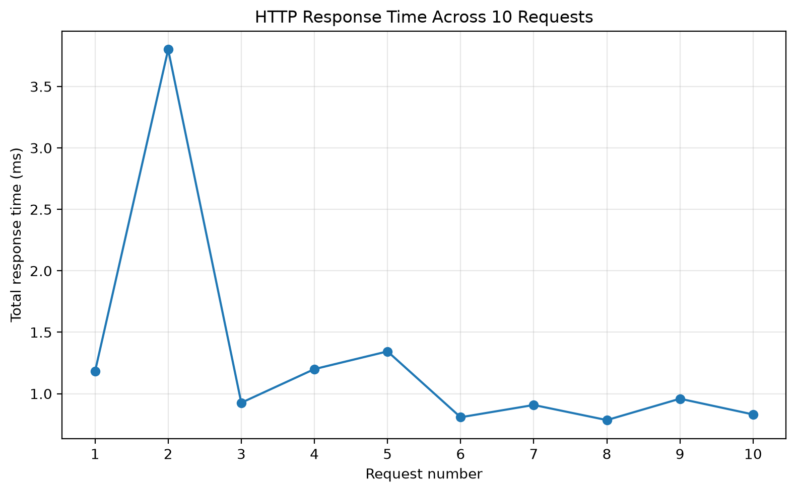
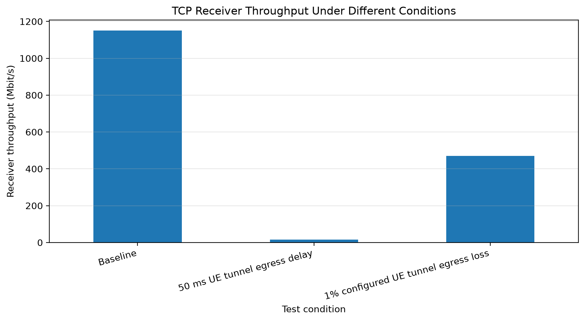
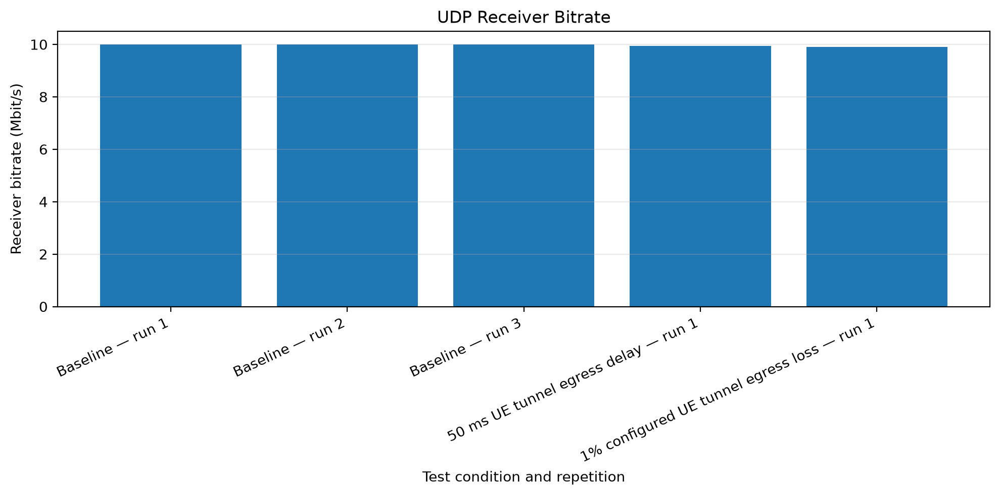
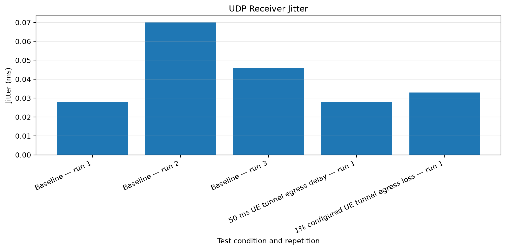
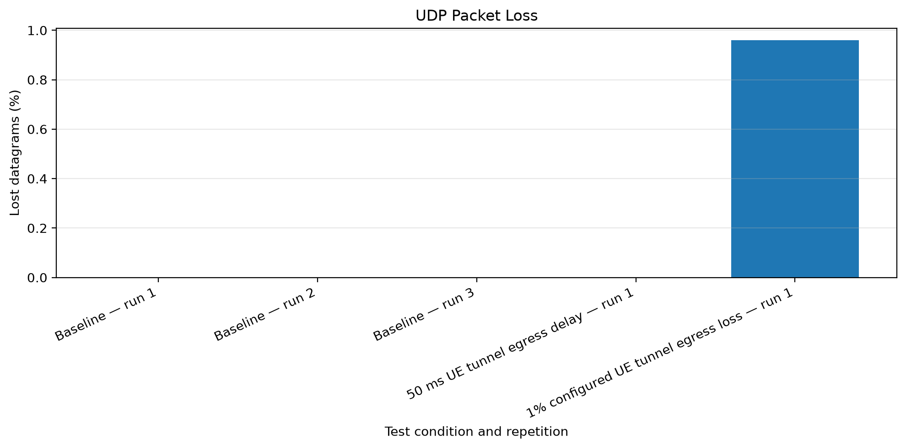

# 5G Network Deployment and Performance Evaluation — Scenario B

## Project Overview

This project deploys and evaluates a container-based 5G Standalone network using Open5GS and UERANSIM.

## Architecture

UE → gNB → N3 (GTP-U/UDP) → UPF → application network

The control plane includes AMF, SMF, NRF, UDM, AUSF, UDR and PCF.

## Main Lab Addresses

| Component | Address |
|---|---|
| Docker core network | 172.19.0.0/16 |
| gNB | 172.19.0.10 |
| UE container | 172.19.0.12 |
| SMF | 172.19.0.13 |
| UPF | 172.19.0.14 |
| Nginx application | 172.19.0.20 |
| iperf3 server | 172.19.0.21 |
| UE tunnel | 10.45.0.2 |
| UPF tunnel gateway | 10.45.0.1 |

## Repository Contents

- `docker-compose.yml`: container deployment
- `config/`: Open5GS and UERANSIM configuration
- `results/`: recorded measurements and summaries
- `captures/`: local packet captures, excluded from Git by default

## Preliminary Results

- Ten HTTP requests returned HTTP 200; each response was 896 bytes.
- Average HTTP total response time across those ten requests was approximately 1.274 ms.
- ICMP baseline: 20 packets received, 0% loss, average RTT 2.244 ms.
- TCP baseline: three runs recorded approximately 1.15 Gbit/s receiver throughput.
- UDP baseline: three runs at 10 Mbit/s recorded no datagram loss.
- Preliminary delay and 1% packet-loss experiments were performed on the UE tunnel egress interface `uesimtun0`.

## Limitations and Further Work

These are preliminary measurements from a container-based lab. More repeated tests, a 20 Mbit/s rate-limit experiment, separate N3 and N6 impairment tests, control-plane evidence, structured CSV analysis, plots and failure diagnosis are still needed for a complete evaluation.

## Safety

Review the configuration before deployment. Do not expose lab management interfaces or MongoDB publicly. Do not commit passwords, subscriber secrets, private keys or tokens.

## Measurement Results and Graphs

### HTTP Response Time

### TCP Receiver Throughput

### UDP Receiver Throughput

### UDP Jitter

### UDP Packet Loss

Measurement data: `results/measurement-data.csv`

Regenerate charts with `.venv/bin/python scripts/plot_results.py`.

Note: These are preliminary results; additional repeated tests are needed.
